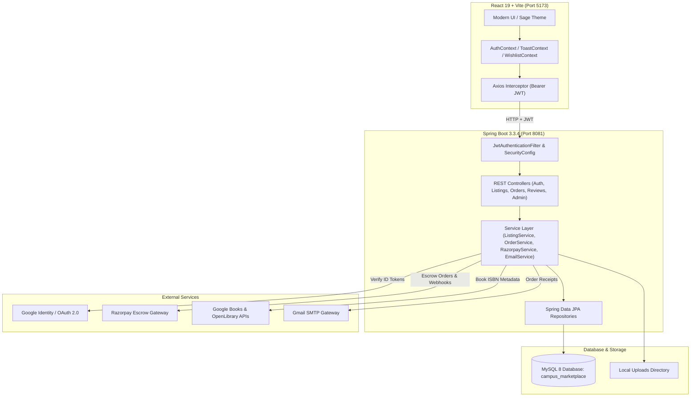
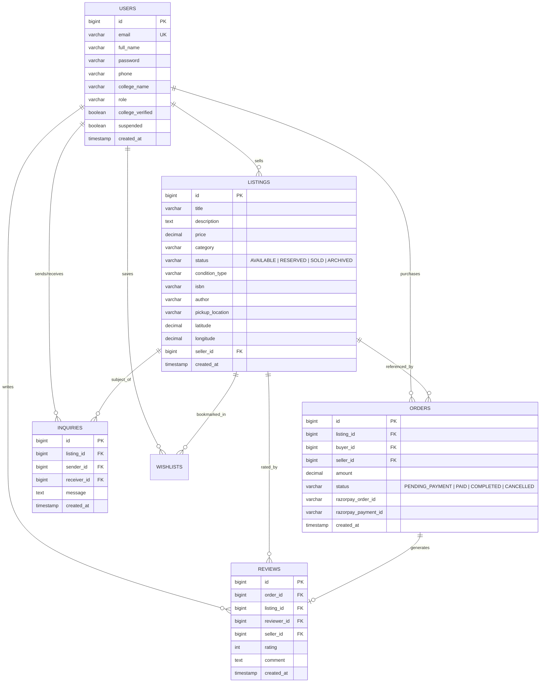
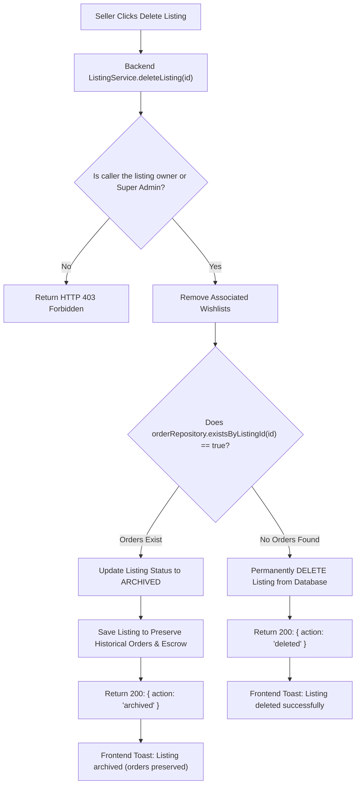

# 🎓 CampusLoop — Student Campus Marketplace

[](https://react.dev/)
[](https://vitejs.dev/)
[](https://www.oracle.com/java/)
[](https://spring.io/projects/spring-boot)
[](https://spring.io/projects/spring-security)
[](https://www.mysql.com/)
[](https://razorpay.com/)
[](https://junit.org/junit5/)
[](LICENSE)

> **CampusLoop** is a modern, student-exclusive peer-to-peer campus marketplace web application engineered with **React (Vite)**, **Java 21 Spring Boot**, and **MySQL**. It enables university students to discover, buy, and sell textbooks, electronics, dorm essentials, lab supplies, and stationery with safe physical handovers, Razorpay Escrow protection, Google Identity authentication, and an animated sage-green design system.

---

## 📑 Table of Contents

- [Project Architecture & Agent Workflow](#-project-architecture--agent-workflow)
- [Key Features](#-key-features)
- [Technology Stack](#-technology-stack)
- [System Architecture](#-system-architecture)
- [Database Schema & Entity Relationships](#-database-schema--entity-relationships)
- [Listing Deletion & Archival Mechanism](#-listing-deletion--archival-mechanism)
- [Razorpay Escrow Payment Architecture](#-razorpay-escrow-payment-architecture)
- [REST API Endpoints](#-rest-api-endpoints)
- [Environment Configuration](#-environment-configuration)
- [Local Installation & Setup Guide](#-local-installation--setup-guide)
- [Running Automated Tests](#-running-automated-tests)
- [Deployment Guide](#-deployment-guide)

---

## 🤖 Project Architecture & Agent Workflow

### Is this a Single-Agent or Multi-Agent project?

- **Application Architecture**: CampusLoop itself is a **Full-Stack Client-Server Web Application** (React frontend + Spring Boot REST API + MySQL database + Razorpay & Google Cloud external integrations), not an autonomous multi-agent system.
- **Engineering Workflow**: Developed using **Google Antigravity AI** as a **single autonomous agent pair programmer with multiple extensible tools and specialized subagents**:
  - **Tool Orchestration**: Direct workspace file manipulation, shell command execution, automated Maven test verification, browser inspection, and web lookup.
  - **Specialized Subagents**: Subagents are delegated for isolated research, browser UI testing, or background tasks as required.

---

## 🌟 Key Features

### 1. 🎓 Student Authentication & Security
- **Dual Authentication**: Sign in via standard email/password or **Google Identity Services (OAuth 2.0)**.
- **BCrypt Password Hashing**: Passwords are securely hashed with a cost factor of 10.
- **Stateless JWT Authorization**: Signed HMAC-SHA256 tokens stored on the client and sent with every Axios request.
- **Role-Based Access Control**: `ROLE_USER` and `ROLE_SUPER_ADMIN` with ownership verification on mutation endpoints.

### 2. 🛡️ Safe Campus Escrow Payments (Razorpay Integration)
- **Escrow-Protected Handover**: Buyer pays via Razorpay checkout; funds are safely held until physical inspection and handover.
- **HMAC-SHA256 Signature Verification**: Server validates payment signatures to prevent tampered requests.
- **Server-Side Fallback Reconciliation**: Automatically verifies payment status with Razorpay servers if webhooks are delayed.
- **Handover Confirmation Modal**: Physical item inspection is confirmed before escrow release.

### 3. 📚 Smart Textbook & Book Lookup (Google Books + OpenLibrary)
- **Instant Metadata Autofill**: Input a book title or 10/13-digit ISBN to query Google Books (with automatic fallback to OpenLibrary).
- **Auto-population**: Imports author, title, publisher, description, and high-resolution cover photo into listing forms.

### 4. 🗄️ Smart Listing Archival & Foreign Key Protection
- **Foreign Key Preservation**: MySQL foreign key constraints on `orders` and `reviews` remain intact.
- **Zero Order History**: Listing is permanently removed from the database alongside any wishlists.
- **Existing Order History**: Listing is marked as `ARCHIVED`. It immediately disappears from the public marketplace and active seller listings, but historical order receipts and escrow payments remain preserved.

### 5. 🎨 Modern Animated UI & Design System
- **Design Language**: Minimalist sage green (`#DCE7DC`), warm white (`#FAFAF6`), charcoal text (`#20231F`), and earthy accents.
- **Animated Hero Section**: Typewriter rotating text with blinking cursor and floating ambient blobs.
- **Scroll Reveal Animations**: Viewport entrance animations powered by `IntersectionObserver` with `prefers-reduced-motion` compliance.
- **Animated Statistics Counters**: Quadratic ease-out interpolation counting real numbers and currency.
- **Custom Toast Notification System**: Animated notification alerts (`success`, `error`, `warning`, `info`) replacing raw browser `alert()` and `confirm()` dialogs.
- **Responsive 3-Group Navbar**: Centered layout with avatar truncation and responsive mobile drawer.

### 6. 💬 Multi-Buyer Direct Messaging Hub
- **Buyer-Seller Inquiries**: Threaded real-time chat with automatic polling.
- **Quick Reply Chips**: Contextual quick response chips for fast campus coordination.
- **Seller Multi-Buyer Switcher**: Sellers can switch between multiple interested students for a single listing.

### 7. ⭐ Verified Reviews & Moderation Portal
- **Verified Buyer Reviews**: Only students who have paid for an item can leave ratings and feedback.
- **Super Admin Command Portal**: Platform GMV metrics, student ID verification desk, review moderation, user suspension, and CSV transaction exports.
- **Gmail SMTP Notifications**: Automated transactional email receipts and order confirmations.

---

## 💻 Technology Stack

| Layer | Technologies |
|---|---|
| **Frontend** | React 19, Vite 8, React Router DOM 7, Axios, Lucide React, Custom CSS Tokens |
| **Backend** | Java 21 LTS, Spring Boot 3.3.4, Spring Security 6, Spring Data JPA, Hibernate 6, JJWT 0.12.6 |
| **Database** | MySQL 8.0 Community Server / Aiven Cloud MySQL |
| **Payment Gateway** | Razorpay Orders API, Payment Verification (HMAC-SHA256) |
| **External APIs** | Google Identity Services (OAuth2), Google Books API, OpenLibrary API |
| **Email Gateway** | Spring Mail with Gmail SMTP (SSL Port 465) |
| **Testing** | JUnit 5, Mockito, Spring Boot Test, H2 In-Memory DB |
| **Build & Tooling** | Maven 3.9+, npm |

---

## 🏛 System Architecture



---

## 🗄 Database Schema & Entity Relationships



---

## 🛡️ Listing Deletion & Archival Mechanism

When a seller attempts to delete a listing:



---

## 💳 Razorpay Escrow Payment Architecture

1. **Order Creation**: Buyer clicks "Reserve & Pay Escrow". Backend creates an internal order (`PENDING_PAYMENT`) and a Razorpay Order ID.
2. **Checkout Modal**: Razorpay Checkout modal appears on the client.
3. **Signature Verification**: Once the transaction completes, the signature (`razorpay_order_id|razorpay_payment_id`) is HMAC-SHA256 verified against `RAZORPAY_KEY_SECRET`.
4. **Escrow Hold**: Order status transitions to `PAID`. The listing is automatically marked `RESERVED` or `SOLD`.
5. **Campus Meetup & Handover**: Buyer meets the seller at the chosen campus landmark, inspects the item, and clicks **"Confirm Received (Handover)"** in the Buyer Dashboard.
6. **Escrow Release**: Order moves to `COMPLETED`, releasing escrow funds and sending email receipts.

---

## 📡 REST API Endpoints

### Authentication (`/api/auth`)
| Method | Endpoint | Description | Public |
|---|---|---|:---:|
| `POST` | `/api/auth/register` | Register new student account | Yes |
| `POST` | `/api/auth/login` | Login with email/password | Yes |
| `POST` | `/api/auth/google` | Sign in or register with Google OAuth ID token | Yes |
| `PUT` | `/api/auth/profile` | Update contact phone and campus landmark | No |

### Listings (`/api/listings`)
| Method | Endpoint | Description | Public |
|---|---|---|:---:|
| `GET` | `/api/listings` | Search, filter by category/price, sort items | Yes |
| `GET` | `/api/listings/{id}` | Get item details and seller info | Yes |
| `POST` | `/api/listings` | Create a new campus listing | No |
| `PUT` | `/api/listings/{id}` | Update item (Owner only) | No |
| `DELETE` | `/api/listings/{id}` | Delete or Archive listing (Owner only) | No |
| `PATCH` | `/api/listings/{id}/archive` | Explicitly archive listing (Owner only) | No |
| `GET` | `/api/listings/my` | Get current seller's active listings | No |

### Orders & Payments (`/api/orders`)
| Method | Endpoint | Description | Public |
|---|---|---|:---:|
| `POST` | `/api/orders` | Create escrow purchase order | No |
| `POST` | `/api/orders/{id}/verify-payment` | Verify Razorpay payment signature | No |
| `POST` | `/api/orders/{id}/reconcile` | Reconcile payment with Razorpay API | No |
| `POST` | `/api/orders/{id}/complete` | Confirm item handover & release escrow | No |
| `GET` | `/api/orders/my-orders` | Get buyer purchase history | No |

### Reviews & Ratings (`/api/reviews`)
| Method | Endpoint | Description | Public |
|---|---|---|:---:|
| `POST` | `/api/reviews` | Submit verified buyer review | No |
| `GET` | `/api/reviews/listing/{id}` | Get verified reviews for a listing | Yes |

### Messages & Inquiries (`/api/inquiries`)
| Method | Endpoint | Description | Public |
|---|---|---|:---:|
| `POST` | `/api/inquiries` | Send inquiry to seller | No |
| `GET` | `/api/inquiries/conversations` | Get all user chat threads | No |
| `POST` | `/api/inquiries/{id}/replies` | Reply to conversation thread | No |

### Super Admin (`/api/admin`)
| Method | Endpoint | Description | Public |
|---|---|---|:---:|
| `GET` | `/api/admin/metrics` | Platform GMV, users, orders overview | Admin |
| `GET` | `/api/admin/users` | Manage student user accounts | Admin |
| `PATCH` | `/api/admin/users/{id}/suspend` | Suspend or unsuspend student account | Admin |
| `GET` | `/api/admin/verifications` | Student ID verification queue | Admin |
| `POST` | `/api/admin/verifications/{id}` | Approve or reject student ID badge | Admin |
| `GET` | `/api/admin/export/transactions` | Export transactions as CSV | Admin |

---

## ⚙️ Environment Configuration

### Backend (`backend/src/main/resources/application.yml`)
```yaml
server:
  port: ${PORT:8081}

spring:
  datasource:
    url: ${DB_URL:jdbc:mysql://localhost:3306/campus_marketplace?createDatabaseIfNotExist=true&useSSL=false&allowPublicKeyRetrieval=true&serverTimezone=UTC}
    username: ${DB_USERNAME:root}
    password: ${DB_PASSWORD:MySql@2026}
  mail:
    host: ${SPRING_MAIL_HOST:smtp.gmail.com}
    port: ${SPRING_MAIL_PORT:465}
    username: ${SPRING_MAIL_USERNAME:your-email@gmail.com}
    password: ${SPRING_MAIL_PASSWORD:your-app-password}

razorpay:
  key-id: ${RAZORPAY_KEY_ID:rzp_test_Tr0vZ94TcR5yD8}
  key-secret: ${RAZORPAY_KEY_SECRET:your-razorpay-secret}

jwt:
  secret: ${JWT_SECRET:404E635266556A586E3272357538782F413F4428472B4B6250645367566B5970337336763979244226452948404D6351}
```

### Frontend (`frontend/.env`)
```bash
VITE_API_URL=http://localhost:8081
VITE_RAZORPAY_KEY_ID=rzp_test_Tr0vZ94TcR5yD8
VITE_GOOGLE_CLIENT_ID=your-google-oauth-client-id.apps.googleusercontent.com
```

---

## 🚀 Local Installation & Setup Guide

### Prerequisites
- **Java 21 LTS** installed (`java -version`)
- **Node.js 18+** installed (`node -v`)
- **MySQL 8.0+** running locally on port 3306
- **Maven 3.8+** (or use the included wrapper `./mvnw`)

### 1. Clone the Repository
```bash
git clone https://github.com/Pavankm70/Student-Market-place-.git
cd Student-Market-place-
```

### 2. Configure MySQL Database
Start your local MySQL service and verify or create the database:
```sql
CREATE DATABASE IF NOT EXISTS campus_marketplace;
```

### 3. Start the Spring Boot Backend
```bash
cd backend
mvn clean spring-boot:run
```
- REST API starts at: `http://localhost:8081`
- Swagger Documentation: `http://localhost:8081/swagger-ui/index.html`

### 4. Start the React Frontend
Open a new terminal window:
```bash
cd frontend
npm install
npm run dev
```
- Web Application opens at: `http://localhost:5173`

---

## 🧪 Running Automated Tests

The backend test suite covers entity relationships, cascade deletions, ownership rules, Razorpay signatures, and repository filters.

```bash
cd backend
mvn test
```

**Results**: All **69 unit and integration tests pass with 0 failures and 0 errors**.

---

## 🚢 Deployment Guide

### Frontend Deployment (Vercel / Netlify)
1. Link your repository.
2. Root directory: `frontend`.
3. Build command: `npm run build`.
4. Output directory: `dist`.
5. Set environment variable:
   ```bash
   VITE_API_URL=https://your-backend-api.com
   ```

### Backend Deployment (Render / Railway / AWS / Docker)
A `Dockerfile` and `docker-compose.yml` are provided in the repository root:
```bash
docker-compose up --build -d
```
Or build the executable JAR:
```bash
cd backend
mvn clean package -DskipTests
java -jar target/campus-marketplace-1.0.0.jar
```

---

## 📄 License

This project is licensed under the [MIT License](LICENSE).
